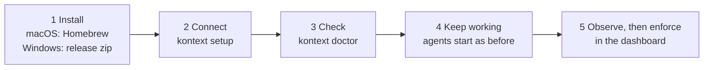
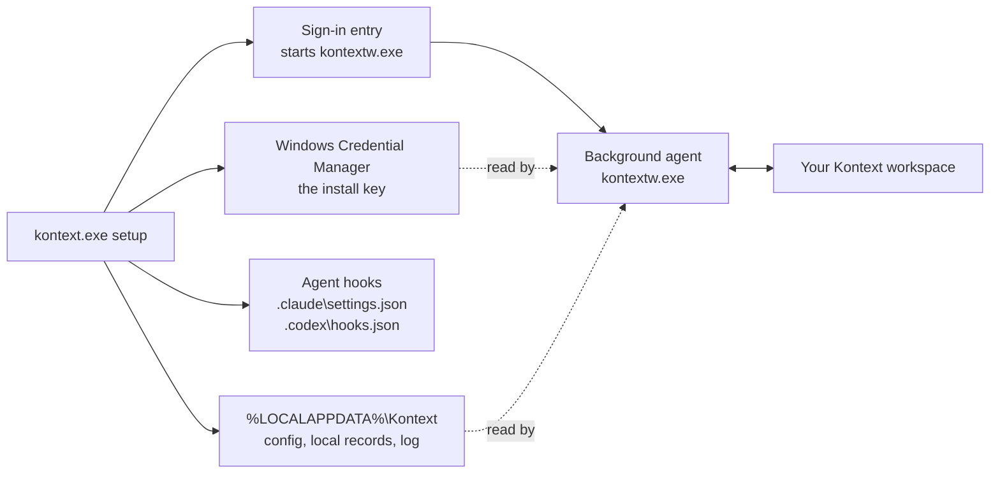
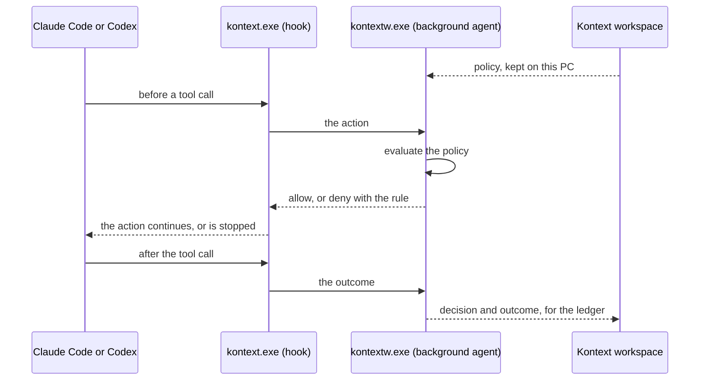

# Kontext on Windows

Kontext works the same way on every system, and so does the way into it:



This page follows those steps for a Windows PC and says what is different
there. Policy, modes and the ledger are described in the
[README](../README.md).

- Windows 11, x64 and Arm.
- Agents: Claude Code and Codex.
- No administrator rights needed: everything is installed for your user.

## 1. Install

Each [release](https://github.com/kontext-security/kontext/releases/latest) has
one zip per architecture, `kontext_<version>_windows_amd64.zip` and
`kontext_<version>_windows_arm64.zip`, with two programs: `kontext.exe`, the
command line tool and the hook the agents call, and `kontextw.exe`, the
background agent. Download the zip for your PC and `checksums.txt`, then in
PowerShell, in the folder you downloaded them to:

```powershell
$zip = Get-Item kontext_*_windows_*.zip
# The hash must be the one checksums.txt lists for this zip.
(Get-FileHash $zip -Algorithm SHA256).Hash.ToLower()
Select-String -Path checksums.txt -Pattern $zip.Name

$dir = "$env:LOCALAPPDATA\Programs\Kontext"
Expand-Archive $zip -DestinationPath $dir
cd $dir
.\kontext.exe --version
```

Keep both programs together in a folder that stays where it is: setup writes
that folder into the agents' hooks and into the entry that starts the
background agent when you sign in. If you move it, run setup again from the new
place.

## 2. Connect

Create an install token in the
[Kontext dashboard](https://app.kontext.security), then run setup from the
folder you unzipped to, in PowerShell on your own desktop. An SSH session
cannot reach the credential store, so setup refuses to run there.

```powershell
.\kontext.exe setup
```

Setup asks for the token, checks it with your workspace, and then writes four
things, all inside your user profile:



## 3. Check

```powershell
.\kontext.exe doctor
```

Doctor shows whether the background agent runs, whether it reaches your
workspace, and which agents are wired.

Codex runs hooks only after you trust them: start `codex` once after setup and
trust the Kontext hooks when it asks, or in `/hooks`. Until then Codex is
neither observed nor stopped, and doctor says so. Setup looks for Codex when it
runs; if you install Codex later, run setup again.

## 4. Keep working

Nothing changes in how you start Claude Code or Codex. Before a tool call runs,
the agent calls the hook; the hook asks the background agent on this PC, which
holds the policy; the answer goes back before the action starts.



## 5. Observe, then enforce

In observe mode a rule that would deny is recorded and the action continues. In
enforce mode the action is stopped before it runs. You switch rules from one to
the other in the dashboard, as on every system; nothing is done on the PC.

## Remove Kontext

```powershell
.\kontext.exe setup --uninstall
```

This removes the install key, the hooks, the sign-in entry and the config, and
stops the background agent. It keeps the two programs, the installation
identity and the local records under `%LOCALAPPDATA%\Kontext`; delete the
folders to remove those too.

## Machine-wide install with the MSI

> Under active development. The MSI is not code-signed yet, and how a machine
> is enrolled is about to change, so expect breaking changes between releases.

For a rollout through device management, each release also carries an MSI per
architecture, `kontext_<version>_windows_amd64.msi` and
`kontext_<version>_windows_arm64.msi`, with `checksums_windows_msi.txt`. It
installs Kontext for every user of the PC and needs administrator rights. Its
properties, what it installs and the commands are in
[packaging/windows/README.md](../packaging/windows/README.md).

A PC with the MSI does not need the steps above, and `kontext setup` refuses to
add an install of your own beside it.

## Not on Windows yet

- The programs are not code-signed.
- There is no automatic update and no winget package; both are in preparation.
  The repairs the README describes for macOS (`doctor --fix`, hooks restored by
  the background agent) are not described for Windows.
- Agents other than Claude Code and Codex are not hooked, and what desktop apps
  add (Claude Desktop, Cursor, Windsurf, VS Code) is not in the inventory.
- Profiles (`kontext setup` for more than one workspace) are not available.
