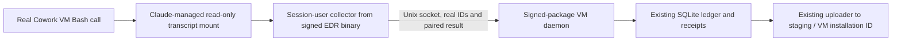

# Internal Cowork EDR test (ENG-1109)

Run the test from Claude Desktop on an Apple silicon Mac. Cowork executes the
sensor inside its local Linux ARM64 VM; the Mac hosts the signed archive and
device profile. No separate container test is required for this milestone.

**Live-test result, 23 November 2026:** the updated signed archive loaded through
Claude's EDR mechanism in VM boot `f72602ad-53f5-41f6-a16f-9caa3db5eadd`.
A real Cowork Bash call (`toolu_018yfMjaAgoeRTrVRUTdNLzx`) reached staging
under VM installation `ins_4jk5F6qCbeGMtOe_EWP9SQ5YPFqrKZub`, action
`act_ecbfcd5d-9caf-5c99-afef-5c0c3e81e083`, as a retrospective observation.
That proof used a foreground import of the actual completed transcript pair.

**Continuous collection is not working:** the signed `collect` client reported
ready, but no future event arrived after its launching Bash call ended. Cowork
appears to reap the tool call's background processes; `nohup` is insufficient.
Do not treat the launch recipe below as a working persistent deployment.
Prototype a daemon-owned attachment/read handle with real mount-lifetime checks,
or use a supported Anthropic lifecycle callback, before declaring coverage.
The Activity UI also hides successful unmatched observation rows; the staging
dashboard API exposes this exact real record with no decision row.

**VM observation path (internal test):** the agent loop is on macOS, so
registering a hook only in the VM does not establish a producer. The actual
local Cowork session exposes its live Claude transcript read-only inside the
VM at `$HOME/mnt/.claude/projects/session/<session-uuid>.jsonl`.

The signed CLI now includes a bounded `cowork-sensor collect` client. Run that
client as the session user: it follows only new records in that user's selected
transcript, reuses the existing Claude transcript parser, and pairs real
`mcp__workspace__bash` calls with their results. It sends only the original
session/tool IDs, command and result-error flag to the EDR daemon's Unix socket.
The daemon stores the existing ledger's retrospective `request.observed` or
`request.failed` row with `adapter_event_name=CoworkTranscriptToolResult`,
`capture_source=cowork.vm_mounted_transcript`, and `native_hook=false`.
It creates no `request.decided`, policy verdict or fabricated native hook.
Only existing redacted summaries are uploaded, with no raw output, prompt or
thinking. The collector has no enrollment credential; only the VM daemon
uploads to staging. The Mac daemon is not involved.



**Limits:** attachment is explicit for this test, for at most 10 minutes and
100 calls (default 3 minutes / one call). There is no automatic per-session
startup yet. The transcript mount is observed implementation behavior, not an
Anthropic EDR API guarantee. This is retrospective VM Bash visibility, not
native hooks, kernel/process tracing or blocking. It does not recover calls
before attachment, report model usage, capture all tools, or provide full
feature-matrix parity. The session-side socket input has the same trust level
as the existing cross-user hook socket; it is not independently attested
kernel evidence. `status` queries the running daemon's installation, version,
boot ID and accepted observation counter; `installed` alone proves none of it.

The daemon remains observe-only, with no model, compactor, Codex proxy,
browser bridge, remote enforcement or device-discovery workers. Existing VM
managed hook registration is retained for compatibility, but is not counted
as the automatic source in this local host-loop deployment.

## Build and sign

Create a separate revocable token in the internal staging dashboard. Save it in
a private file (0600) outside the repository; do not put it in shell arguments,
`.args`, environment configuration committed to Git, or logs.

```sh
python3 scripts/cowork-edr/build.py \
  --cloud-url https://api.staging.kontext.security \
  --token-file /absolute/private/test-token \
  --source-revision BASE_COMMIT \
  --output /absolute/private/package-directory
```

The build uses `GOOS=linux GOARCH=arm64 CGO_ENABLED=0`,
`-tags=nostepsafetymodel`, `-trimpath` and `-buildvcs=false`. The manifest records
the base revision, Go/module source hash and binary hash. Preserve the source
patch alongside the build when testing an uncommitted change. Reuse the
generated installation ID with `--installation-id` to reproduce identical bytes
for the same source, token and configuration. The archive contains a private
test credential and must stay restricted to the internal test.

```sh
gcloud auth login --account=jens@kontext.security
cd scripts/cowork-edr/sign
go test ./...
go run . --archive /absolute/private/package.tar.gz \
  --public-key ../approved-public-key.asc --key-version 1
```

The signer verifies that KMS version 1 matches approved fingerprint
`BBBDFE996C02A0E482F116A6DE2037B4E5CF93B9`. The OpenPGP library creates a binary
detached signature over the archive with a 30-day lifetime and no notation or
policy URI. Only the final SHA-256 digest reaches KMS; key material never leaves
KMS. Request/response CRC32C and the returned ECDSA signature are checked. The
finished OpenPGP signature is verified locally before writing `.sig`.

## Mac deployment

Verify `.sig` with the approved public key before staging the package. Run
`sudo sh scripts/cowork-edr/stage-mac.sh /absolute/private/package.tar.gz`.
It installs root-owned, admin-readable files below
`/Library/Application Support/KontextCoworkEDR` and rejects writable ancestors.
The internal archive is not readable by ordinary non-admin users.

```sh
python3 scripts/cowork-edr/mac-profile.py --output /absolute/path/test.mobileconfig
```

The profile contains only the package path and vendor ID, scoped to System.
The partner guide documents MDM deployment. For this one-Mac QA test, manually
installing the same System profile supplies forced device preferences; verify
that Claude actually recognizes them through its diagnostics. A user preference
written with `defaults write` does not replace this device policy.

Quit Claude fully and reopen it. In Settings → Cowork, enable **Only on this
computer** before creating a new task. Confirm the task URL uses `local_` and
the task displays "Only on this computer". A `cse_` cloud task does not test VM
hook delivery, even when a connected Mac is shown. Use one tool
call such as:

```sh
mkdir -p /tmp/kontext-edr-eng1109-empty && ls -la /tmp/kontext-edr-eng1109-empty
```

Inside the VM, install.sh copies all files out of the unpack directory, creates
the unprivileged `kontext-cowork` account, and starts the sensor with systemd or
`setpriv` without capabilities. Startup must authenticate to staging before the
installer returns success. Re-running it stops and replaces its own service.
Failure removes its hook drop-in and returns nonzero. It never installs OS
packages or downloads dependencies.

The cross-user socket is `/run/kontext-cowork/sensor.sock` (0666), inside a
service-owned directory (0755) that other session users cannot modify. Config,
credential and state are private. The root-owned hook drop-in is
`/etc/claude-code/managed-settings.d/95-kontext-cowork.json`.

The following attachment recipe was tested and **failed to persist across tool
calls**. Keep it as a regression scenario. Inside the actual local task, attach
the installed client before a separate
harmless tool call. Use the task's transcript UUID (not its `local_` UI ID):

```sh
/usr/local/lib/kontext-cowork/kontext cowork-sensor status
nohup /usr/local/lib/kontext-cowork/kontext cowork-sensor collect \
  --session-id YOUR_TRANSCRIPT_UUID --duration 3m --max-events 1 \
  > /tmp/kontext-eng1109-collector.log 2>&1 < /dev/null &
```

Confirm `COLLECTOR_READY` in that log, then request a **separate** real Cowork
Bash call such as `printf '%s\n' 'kontext-eng1109-vm-real-call'`.
The collector should log `OBSERVATION_ACK` with the actual tool ID and ledger
action ID. Do not manually construct JSON or invoke `kontext hook` for this
acceptance check. Match the action/session/tool IDs and redacted marker in
staging under this package's installation ID. Verify the row has source
`cowork.vm_mounted_transcript` and no authorization decision. No host endpoint
may count as evidence.

Generate a Claude diagnostic report and inspect `cowork-edr-integration.txt`
to verify that the **updated** archive was vendor-verified and installed in
the same VM boot. A fresh signed archive needs staging in the protected Mac
package path and a full Claude restart/VM boot through the EDR loader.

## Removal

Stop the test sensor inside the VM by running its root removal entry point:
`/usr/local/lib/kontext-cowork/uninstall.sh`. It stops only its own process and
removes its own hook file, unit, binary, credentials and state. The locked
service account remains and can be reused on reinstall. If a session cannot
run a root command, deliver a separately signed removal package through the
same approved installer mechanism; do not bypass VM privileges.

Remove the System profile from Mac Device Management and remove the staged
package directory as administrator. Removing the profile alone does not remove
an already installed VM sensor. Finally revoke the dedicated staging token by
its ENG-1109 label and remove credential-bearing archives and the private token
file. Do not revoke a shared Mac enrollment token.

## Checks

```sh
go test -race -tags=nostepsafetymodel,integration ./internal/coworksensor
go test -tags=nostepsafetymodel ./internal/localruntime ./internal/runtimehost ./internal/managedstream
cd scripts/cowork-edr/sign && go test ./...
```

The sensor test runs its core runtime on the Mac against an isolated local API
fixture. It checks authentication, rejected credentials, the real hook socket,
ledger upload, fixed observe mode, cross-user socket permissions and the
restricted request scope. The production command itself accepts Linux only.

## Pre-tool enforcement is a separate integration

Anthropic's Enterprise Inference Hooks support an HTTPS policy endpoint and
`tool_call` allow/deny checks before execution when Validate tool calls is on:
https://platform.claude.com/docs/en/manage-claude/inference-hooks

This is separate from both the EDR package loader and local Claude Code hooks.
The published EDR program currently uses detection mode, without blocking:
https://claude.com/resources/articles/claude-enterprise-security-updates

Reuse the policy evaluator behind an Enterprise hook endpoint if this is the
required enforcement channel; signing a VM collector does not create it.
